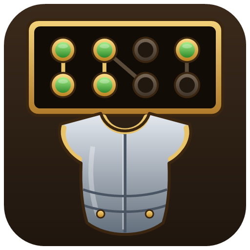

<p align="center"></p>

# Guild Builds

An addon for WoW Forever (the `_forever_` client, 1.60.x) that shows your
guild members' builds in the guild roster: their talent specializations,
opened in the game's own talent window, and the gear sets that go with
them. It also ties your own gear sets to your talents.

- **Specializations in the roster.** In the Class column of the guild
  window's Roster tab, next to each member's class icon, one icon per spec
  group: two with dual spec, Primary then Secondary, the one not active
  dimmed. The icon is the talent tree with the most points. Point at it for
  the tree, the points spent in each tree, its gear sets and when it was
  last updated.
- **Builds in the game's talent window.** Click an icon and the game's talent
  window shows that build, the way it shows a talent build linked in the
  chat: the member's whole class tree with their points, also while they are
  offline. Click it again to close it. Your own icons open your own talents.
- **Gear beside the talents.** The build's gear set shows in a panel beside
  the talent window, its items by slot as in the character window, with
  their tooltips (shift-click links one, control-click tries it on), and
  its item level under its icon: the average of its items, without shirt
  and tabard. A slot the set leaves as it is (ignored in the Equipment
  Manager) shows the game's mark. A build with more sets has a menu to pick
  one, its default first. When only the
  gear is shared, the panel opens beside the guild window. A small button
  by each window's close button opens or closes the other one: the gear
  from the talents, the talents from the gear (greyed when that part is not
  shared).
- **Gear sets for your talents.** Give the gear sets of the game's Equipment
  Manager to your Primary or Secondary talents, one or more each: from the
  menu at the bottom of your talent window, or from the settings button
  (the gear) of each set in the character window. The first set you give to
  some talents is their default, until you pick another. Switching talents
  equips the new ones' default set (after the combat, if you are in one);
  you can turn that off in the same menu. A set given to talents shows their
  main tree in the character window.
- **You choose what to share.** At the bottom of your talent window, two
  boxes for each spec group on its own (the window's Primary and Secondary
  tabs): "Share talents", off until you tick it, and "Share gear", on until
  you untick it. Talents you do not share still show their main tree and
  their points in the roster, as anyone sees by inspecting you, but never
  leave your computer; taking something back removes it from the guild's
  copies too.
- **The gear you wear.** While the talents in use share their gear, what
  you wear is shared too (each item with its item level, and your average
  item level), together with the points you have not spent yet. In the
  gear panel of those talents it comes last, as "Equipped" (with the
  average item level), also for a build without gear sets. Other addons
  can read it from the guild's records too, such as the exporter for the
  guild's Discord bot.
- **Room for the icons.** The Class column gets just wide enough for the
  class icon and two more, and the Note column, the one that stretches,
  gives up that room; the other columns keep their width.
- **Automatic sharing.** Each member's builds go to the rest of the guild
  through hidden addon messages, which never appear in any chat window. When
  you log in, a guild member who is online sends you whatever you are
  missing, so as long as someone with the addon is online, everyone ends up
  with the same builds. Members without the addon show only their class.
- **Every client language.** The addon's texts are in English, German,
  Spanish (EU and Latin America), French, Italian, Korean, Portuguese
  (Brazil, also used by Portugal's client), Russian and Chinese (simplified
  and traditional). Names of trees and talents come from the game.

## Installing

With the CurseForge app, install Guild Builds: the app also installs
**LibGuildSync**, the shared code of the guild addons. By hand, copy the
`GuildBuilds` and `LibGuildSync` folders into
`World of Warcraft\_forever_\Interface\AddOns\`.

## Commands

| Command | What it does |
|---|---|
| `/gbuilds` or `/gbuilds status` | What the addon knows and is doing |
| `/gbuilds sync` | Ask the guild for missing builds now |
| `/gbuilds language [code\|auto]` | Language of the addon's texts |
| `/gbuilds debug` | Show the sync log in the chat |
| `/gbuilds reset` | Forget the builds of your current guild |

`/guildbuilds` works too.

## Tests

The tests run outside the game with Lua 5.1, from the addon's folder, with
the `LibGuildSync` folder next to it (its test harness is shared):

```
lua5.1 Tests\run.lua . Tests
```

`test_versions` runs the last release next to this version, taken from its
git tag.

## Releasing

CurseForge packages every tagged commit pushed here.

1. Raise `## Version` in `GuildBuilds.toc` and add that version's entry at
   the top of `CHANGELOG.md`. The tests check that both match. If
   `ANNOUNCE_AS` is set in `Core.lua` (a version tried in game while telling
   the guild it is the last release), set it to nil. The tests print a note
   while it is on.
2. Commit, tag the commit `v<version>` and push the tag:
   `git push origin v<version>`. A tag containing `beta` or `alpha` makes a
   beta or alpha file instead of a release.
3. CurseForge builds the zip as `.pkgmeta` says: the `GuildBuilds` folder
   without the tests, with `CHANGELOG.md` as the file's changelog.

## License

MIT. See [LICENSE](LICENSE).
